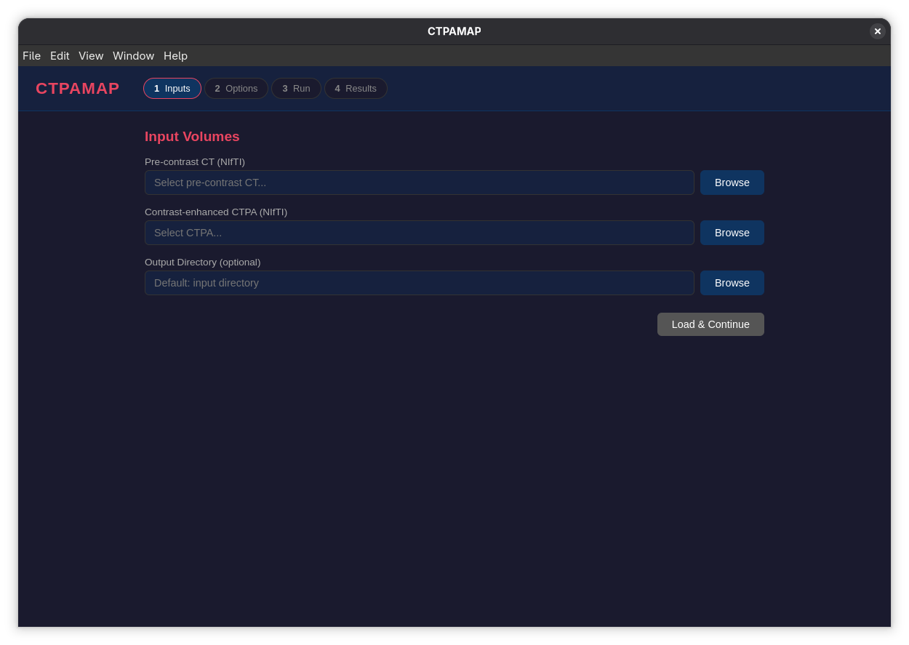

# CTPAMAP

**Lung subtraction CTPA perfusion mapper — from paired non-contrast and contrast-enhanced chest CT to an iodine/perfusion map.**

CTPAMAP registers a non-contrast (“pre”) chest CT to a contrast-enhanced CT pulmonary angiogram (CTPA), subtracts the two volumes, and produces a lung iodine/perfusion map that highlights contrast defects such as those seen in pulmonary embolism. It ships as a Python package with a batch CLI, a FastAPI backend, and an Electron + React desktop GUI with an embedded NIfTI viewer.

> **Research and educational software — not a medical device.** It has not been validated for clinical diagnosis.



*The CTPAMAP desktop GUI: a four-step wizard over the same Python pipeline used by the CLI, with an embedded NIfTI viewer for the resulting maps.*

---

## Table of contents

- [Why subtraction CTPA](#why-subtraction-ctpa)
- [Features](#features)
- [Pipeline](#pipeline)
- [Registration backends](#registration-backends)
- [Installation](#installation)
- [Command-line usage](#command-line-usage)
- [Outputs](#outputs)
- [Desktop GUI](#desktop-gui)
- [Prebuilt releases](#prebuilt-releases)
- [REST API](#rest-api)
- [Repository layout](#repository-layout)
- [Conventions](#conventions)
- [Testing](#testing)
- [Slicer extension](#slicer-extension)
- [Limitations](#limitations)

---

## Why subtraction CTPA

A CTPA shows the pulmonary arterial tree brightly, but visual assessment of *parenchymal* perfusion is indirect. Pairing the CTPA with a non-contrast scan of the same patient makes it possible to subtract the baseline lung attenuation and estimate how much iodine reached each lung region:

```
iodine ≈ f(CTPA) − f(pre)
```

After spatial registration, lung/airway/vessel segmentation, and optional aeration correction, the difference image approximates regional pulmonary blood volume. Areas of reduced iodine uptake can then be compared with the arterial tree — for example, a perfusional defect downstream of an occluding embolus.

The hard parts are registration (the two scans are acquired at different times and breath-holds) and preserving the iodine signal through that registration. CTPAMAP exposes several registration strategies, including a vesselness-driven mutual-information + B-spline backend designed specifically to avoid smearing the contrast difference.

---

## Features

- **Paired-volume pipeline** — pre-contrast CT + CTPA → registered subtraction → iodine map.
- **Four registration backends** — SimpleITK rigid NCC + Demons (default), vesselness-driven MI + B-spline (recommended), ANTs SyN, ITK-Elastix, plus optional FireANTs GPU registration.
- **Lung, airway, and vessel segmentation** with the option to skip segmentation.
- **Aeration correction** using the Jacobian determinant of the deformation field.
- **Quality control report** (`qc_report.json`) with registration/displacement checks and artifact detection.
- **Batch CLI** with full control over spacing, clipping, registration, segmentation, and correction.
- **Desktop GUI** — four-step wizard (Inputs → Options → Run → Results), live job progress, result list with download links, and an embedded NIfTI viewer.
- **FastAPI backend** — the GUI calls the same `run_pipeline` function as the CLI; no duplicated maths.
- **NIfTI-native** — RAS-oriented, nibabel `(X, Y, Z)` arrays, mm-based displacement fields.

---

## Pipeline

```
load
  → reorient to RAS
  → resample both volumes to a common grid
  → clip HU
  → denoise
  → segment (lung / airway / vessel)
  → register pre → CTPA
  → [aeration correction]
  → subtract
  → iodine map
  → overlay
  → QC report
```

Each stage is implemented as a separate module (`preprocessing`, `segmentation`, `registration*`, `subtraction`, `overlay`, `qc`, `jacobian`), so individual pieces can be reused or replaced.

---

## Registration backends

| Backend | Flag | Method | Notes |
|---------|------|--------|-------|
| Default | *(none)* | SimpleITK multi-resolution rigid NCC + Demons SDFF | Fast, general-purpose; `--agg` adds SDF lung-boundary alignment |
| Vesselness | `--vessel` | Frangi vesselness + MI + B-spline | **Recommended.** Contrast-invariant vesselness term reduces smearing of the iodine signal; returns a composite transform and always yields a DDF |
| ANTs | `--antspy` | ANTs SyN | Requires `pip install ctpamap[antspy]` |
| Elastix | `--stix` | ITK-Elastix | Requires `pip install ctpamap[elastix]` |
| FireANTs | `--gpu` | FireANTs GPU registration | Requires `pip install ctpamap[fireants]` and a CUDA-capable GPU |

Other registration controls:

- `--no-reg` — skip registration and use the common-grid pre-contrast volume directly
- `--agg` / `--agglite` — aggressive deformable registration variants
- `--rigid-z` — coarse z-translation pre-scan for large slice offsets

---

## Installation

### Requirements

- Python ≥ 3.10
- NumPy, SciPy, nibabel, SimpleITK, scikit-image, matplotlib
- Node.js ≥ 18 and npm for the desktop GUI
- Optional: ANTsPy, ITK-Elastix, FireANTs, CuPy depending on the backend

### Python package and CLI

```bash
git clone https://github.com/lippisch2/CTPAMAP.git
cd CTPAMAP
make setup          # venv with --system-site-packages + editable install
```

`make setup` is equivalent to:

```bash
python3 -m venv --system-site-packages venv
venv/bin/pip install --upgrade pip
venv/bin/pip install -e ".[dev]"
```

Check the install:

```bash
venv/bin/ctpamap --version
venv/bin/ctpamap --help
```

### Optional backends

```bash
venv/bin/pip install -e ".[antspy]"    # ANTs SyN
venv/bin/pip install -e ".[elastix]"   # ITK-Elastix
venv/bin/pip install -e ".[fireants]"  # FireANTs GPU
venv/bin/pip install -e ".[napari]"    # napari viewer
```

---

## Command-line usage

```bash
ctpamap <pre> <ctpa> [-o OUT] [OPTIONS]
```

Typical run:

```bash
venv/bin/ctpamap pre.nii.gz ctpa.nii.gz -o out/
```

Recommended subtraction CTPA configuration:

```bash
venv/bin/ctpamap pre.nii.gz ctpa.nii.gz -o out/ --vessel --aer
```

Full option list:

| Option | Description |
|--------|-------------|
| `-o, --out OUT` | Output directory (default: `<input dir>/ctpamap_output`) |
| `--spacing SX SY SZ` | Target spacing in mm (default `1.5 1.5 1.5`) |
| `--hd` | Use the finest native voxel spacing instead of `--spacing` |
| `--no-reg` | Skip registration; use the common-grid pre-contrast volume directly |
| `--agg` / `--agglite` | Aggressive deformable registration for contour matching |
| `--noseg` | Skip vessel/airway segmentation |
| `--aer` / `--no-aer` | Aeration correction via the Jacobian determinant |
| `--rigid-z` | Coarse z pre-scan before rigid alignment |
| `--gpu` | FireANTs GPU registration |
| `--noclip` | Keep the full unclipped iodinated dynamic range |
| `--antspy` / `--stix` / `--vessel` | Registration backend selection |
| `-v, --view-n` | View results with the matplotlib/napari viewer |
| `--version` | Print version |

Example with a custom grid and aeration correction:

```bash
venv/bin/ctpamap pre.nii.gz ctpa.nii.gz -o out/ \
  --vessel --aer --spacing 1.0 1.0 1.0
```

---

## Outputs

Artifacts are written to the output directory:

| File | Content |
|------|---------|
| `registered_pre.nii.gz` | Pre-contrast volume warped into CTPA space |
| `ctpa_regrid.nii.gz` | CTPA resampled to the common grid |
| `lung_mask.nii.gz` | Lung segmentation |
| `vessel_mask.nii.gz` | Pulmonary vessel segmentation |
| `airway_mask.nii.gz` | Airway segmentation |
| `iodine_map_raw.nii.gz` | Unprocessed subtraction map |
| `iodine_map_clean.nii.gz` | Masked/denoised iodine map |
| `iodine_overlay.nii.gz` | Iodine map overlaid on the CTPA |
| `qc_report.json` | Registration and artifact QC metrics |

---

## Desktop GUI

The GUI is an Electron + React + TypeScript application that talks to a local FastAPI backend on `127.0.0.1:18923`. The backend spawns automatically when the app starts.

### Workflow

1. **Inputs** — pick the pre-contrast CT, the CTPA, and an optional output directory.
2. **Options** — choose a registration backend and toggle skip-registration, aggressive/lite registration, high-definition spacing, segmentation, aeration correction, GPU registration, and HU clipping; set target spacing.
3. **Run** — the pipeline runs in a background job; the UI polls progress and shows the current stage.
4. **Results** — every output is listed with **View** (embedded NIfTI viewer) and **Download** actions.

### Run the GUI in development

```bash
# Terminal 1 — backend dependencies (once)
pip install -r requirements.txt

# Terminal 2
cd electron-app
npm install
npm run dev
```

`npm run dev` starts the Vite dev server and Electron; `electron/main.ts` spawns `python -m uvicorn ctpamap.api:app` and waits for `/api/status`.

> On Linux, if Electron's sandbox is unavailable, launch with `--no-sandbox`:
> `./node_modules/electron/dist/electron --no-sandbox .`

### Build desktop artifacts

```bash
cd electron-app
npm run build          # renderer/main/preload bundles
npm run build:win      # Windows portable .exe
npm run build:linux    # Linux AppImage
```

Built artifacts are written to `electron-app/dist/`.

---

## Prebuilt releases

Portable builds are attached to [GitHub Releases](https://github.com/lippisch2/CTPAMAP/releases):

| Platform | File |
|----------|------|
| Windows x64 | `CTPAMAP-1.2.0-portable.exe` |
| Linux x64 | `CTPAMAP-1.2.0-x86_64.AppImage` |

Both are **thin Electron shells** around the Python backend. The target machine still needs:

1. Python 3.10+ available as `python` (Windows) or `python3` (Linux).
2. The CTPAMAP package and its dependencies:
   ```bash
   pip install -e .
   pip install -r requirements.txt
   ```
3. Optional registration backends as needed.

Without Python and the package, the app exits after a 30-second backend timeout.

**Linux:**

```bash
chmod +x CTPAMAP-1.2.0-x86_64.AppImage
./CTPAMAP-1.2.0-x86_64.AppImage
```

If FUSE is unavailable, use `--appimage-extract-and-run`.

**Windows:** run the `.exe` directly; it self-extracts to a temporary directory. The build is unsigned, so SmartScreen may warn.

---

## REST API

The backend is a thin wrapper around the same pipeline used by the CLI.

| Method | Endpoint | Purpose |
|--------|----------|---------|
| `GET` | `/api/status` | Health, version, Python version |
| `POST` | `/api/load` | Validate a `{pre, ctpa, out?}` pair and create a session |
| `POST` | `/api/run` | Start a pipeline job `{session_id, params}` → `job_id` |
| `GET` | `/api/run/{job_id}` | Job status, progress percentage, stage, outputs, error |
| `GET` | `/api/nifti?path=<abs>` | Serve a NIfTI file to the viewer |

Run it directly:

```bash
python -m uvicorn ctpamap.api:app --host 127.0.0.1 --port 18923
```

Interactive docs: `http://127.0.0.1:18923/docs`.

---

## Repository layout

```
CTPAMAP/
├── ctpamap/
│   ├── api.py                  # FastAPI backend for the GUI
│   ├── cli.py                  # run_pipeline + argparse CLI
│   ├── preprocessing.py        # load, reorient, resample, clip, denoise
│   ├── segmentation.py         # lung / airway / vessel masks
│   ├── registration.py         # rigid NCC + Demons (default)
│   ├── registration_vessel.py  # vesselness + MI + B-spline
│   ├── registration_antspy.py  # ANTs SyN
│   ├── registration_elastix.py # ITK-Elastix
│   ├── registration_fireants.py# FireANTs GPU
│   ├── subtraction.py          # iodine map generation
│   ├── overlay.py              # overlay rendering
│   ├── qc.py                   # QC report
│   ├── jacobian.py             # displacement field → Jacobian
│   ├── sctviewer.py            # matplotlib viewer
│   ├── sctviewern.py           # napari viewer
│   └── IodineHeat256.txt       # iodine colour table
├── electron-app/
│   ├── electron/               # main process + preload bridge
│   ├── src/                    # React wizard + NIfTI viewer
│   ├── electron.vite.config.ts
│   └── package.json
├── tests/                      # pytest suite
├── docs/ctpamap-gui.png        # GUI screenshot
├── Makefile
├── pyproject.toml
├── requirements.txt
└── README.md
```

---

## Conventions

- Volumes are reoriented to canonical **RAS**.
- NumPy arrays use nibabel **(X, Y, Z)** order.
- Displacement fields from every backend are **(3, Z, Y, X)** mm in SimpleITK voxel order (components x, y, z) — see `jacobian.displacement_to_jacobian`.
- QC axial slices and diaphragm displacement use the affine-derived **I/S axis (axis 2)** on the RAS grid.
- Aeration correction passes spacings in **(sz, sy, sx)** order so anisotropic data is handled correctly.

---

## Testing

```bash
make test
# or
venv/bin/pytest -q
```

The tests cover the pipeline modules and the Slicer-vendored core snapshot (`make slicer-test`).

---

## Slicer extension

The 3D Slicer extension (`SlicerCTPAMap/`) is intentionally **excluded from this repository** and maintained separately. The `make slicer-sync` target copies the core modules into a Slicer extension tree when working on that integration.

---

## Limitations

- **Research use only** — no clinical validation, no regulatory clearance.
- **Registration quality dominates the result.** Large breath-hold differences, motion, or metal artefact can produce misleading subtraction maps.
- **CTPAMAP assumes the two volumes are the same patient and comparable geometry.** It does not perform patient matching.
- **HU clipping** removes extreme values by default; use `--noclip` only when you understand the dynamic range implications.
- **Aeration correction** requires a valid deformation field; it is unavailable when registration is skipped.
- **Optional backends** (ANTs, Elastix, FireANTs, napari) are not installed by default and may require system libraries or CUDA.
- **The portable GUI is not fully self-contained** — it needs Python and the package on the host.

---

## Disclaimer

CTPAMAP is intended for research and educational purposes. It is **not** a medical device, has **not** been validated for clinical diagnosis, and must not be used to make patient-care decisions.
